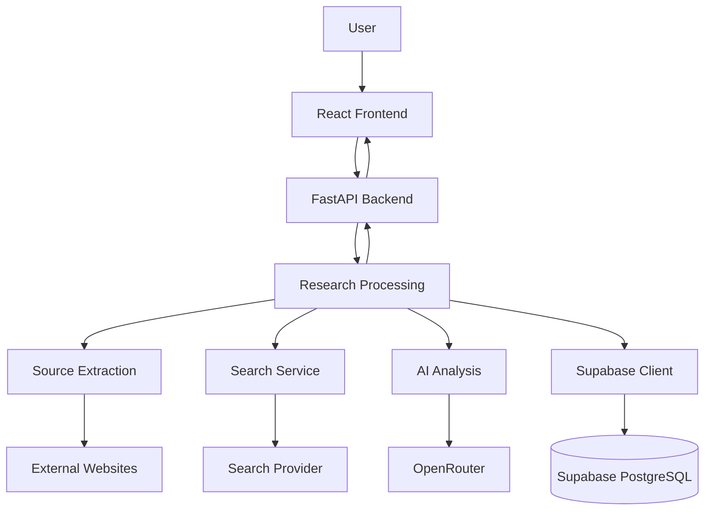

# ClarityX 🔍

### AI-Powered Information Gap Detection Platform

> Don't just tell users what you found. Tell them what you haven't found.

## 📌 Overview

ClarityX is an AI-powered platform designed to identify information gaps across multiple digital sources.

When researching a topic, users often encounter missing information, outdated content, conflicting claims, and unverified statements.

Traditional search engines help users discover information, but they do not always highlight what is missing or what still needs verification.

ClarityX addresses this challenge by analysing multiple sources and generating structured research reports that highlight available information, identify gaps, and recommend what users should investigate next.

## 🎯 Problem Statement

**Digital Dark Spot – AI-Assisted Information Gap Detection Platform**

Information is scattered across multiple digital sources. Determining whether that information is complete, current, consistent, and supported by evidence requires considerable manual effort.

ClarityX aims to make these information gaps visible through AI-assisted research analysis.

## 🚦 Project Status

- **Status:** Phase 1 Backend Foundation, Phase 2 Supabase Database Setup, Phase 3 Authentication & Research Session Persistence, and Phase 4 (Checkpoint 1 UI Design System & Checkpoint 2 Frontend Auth & Backend Integration) implemented.
- **Implemented:**
  - Complete architectural specifications, database schemas, and API documentation in `docs/`.
  - **FastAPI backend foundation (Phase 1):** Modular application structure, centralized settings, CORS middleware for `localhost:5173`, standardized JSON exception handling, `GET /` and `GET /health` endpoints, and automated pytest suite.
  - **Supabase Database Setup (Phase 2):** Centralized Supabase client with safe URL normalization, administrative client integration, pre-table live connectivity verification CLI (`python -m app.database.supabase`), initial schema migration (`001_initial_schema.sql` with 6 tables, cascade foreign keys, cross-session validation triggers, `auth.users` profile synchronization, 9 performance indexes, and comprehensive Row Level Security policies), database repository abstractions (`BaseRepository`, `ProfileRepository`, `ResearchRepository`), and automated database test suite.
  - **Authentication & Research Persistence (Phase 3):** Supabase Auth JWT token verification dependency (`get_current_user`), `GET /api/auth/me` user profile route, full authenticated CRUD for research sessions (`GET /api/research`, `POST /api/research`, `GET /api/research/{id}`, `PATCH /api/research/{id}`, `DELETE /api/research/{id}`), with 70 passing backend pytest tests.
  - **Frontend UI Design System (Phase 4, Checkpoint 1):** Modern React 19 + Vite frontend implementing the 5-color palette (`#2B2D42`, `#8D99AE`, `#EDF2F4`, `#EF233C`, `#D90429`), hybrid Glassmorphism + Neumorphism tactile surfaces, responsive layouts with desktop sidebar and mobile navigation drawer.
  - **Frontend Auth & Backend Integration (Phase 4, Checkpoint 2):** Supabase client (`@supabase/supabase-js`), centralized `AuthContext` with session restore on reload and automatic token injection, `LoginPage` and `RegisterPage` with email confirmation awareness and validation, protected routing (`ProtectedRoute` and `PublicOnlyRoute`), backend profile integration (`GET /api/auth/me`), and live connection of all 5 views to real FastAPI database endpoints (zero mock/sample data fallback). End-to-end multi-user Row Level Security isolation verified.
- **Not Yet Implemented (Planned):**
  - Source extraction service (Trafilatura / Jina Reader) and optional DuckDuckGo search discovery (Phase 5).
  - OpenRouter AI analysis engine, evidence quote verification, and research gap detection persistence (Phase 6).

## ✨ Key Features (Planned)

- **Multi-Source Analysis:** Analyse information from multiple URLs and supported text inputs.
- **Missing Information Detection:** Identify important information that is absent from available sources.
- **Outdated Information Detection:** Highlight potentially outdated information using available dates and context.
- **Conflict Detection:** Identify disagreements between different sources.
- **Unverified Claims:** Highlight claims that lack sufficient supporting evidence.
- **Evidence and Citations:** Connect findings to relevant sources and evidence excerpts.
- **Verification Checklist:** Generate actionable tasks for unresolved information.
- **Research History:** Save and revisit previous research reports.

## 🛠️ Technology Stack

### Frontend

- React
- Vite
- JavaScript (JSX)
- Tailwind CSS v4
- shadcn/ui
- Base UI
- Lucide React

### Backend

- Python
- FastAPI
- Pydantic
- Uvicorn

### Database

- Supabase
- PostgreSQL
- Supabase Authentication

### AI and Integrations

- OpenRouter
- Trafilatura
- Jina Reader
- DuckDuckGo Search
- HTTPX

## 🏗️ System Architecture



## 📁 Project Structure

```text
ClarityX/
│
├── docs/
│   ├── PRD.md
│   ├── DESIGN.md
│   ├── ARCHITECTURE.md
│   ├── DATABASE.md
│   └── API.md
│
├── AGENTS.md
├── README.md
├── .gitignore
│
├── frontend/
│   ├── src/
│   ├── public/
│   ├── package.json
│   └── vite.config.js
│
└── backend/
    ├── app/
    │   ├── routes/
    │   ├── services/
    │   ├── database/
    │   ├── schemas/
    │   └── main.py
    │
    ├── tests/
    ├── requirements.txt
    ├── .env
    └── venv/
```

## 🚀 Getting Started

The following setup instructions describe the planned development environment. Backend and Supabase configuration will be completed during implementation.

### Prerequisites

Install the following:

- Node.js and npm
- Python 3.10 or later
- Git
- A Supabase account
- An OpenRouter API key

### 1. Clone the Repository

```bash
git clone YOUR_REPOSITORY_URL
cd ClarityX
```

### 2. Frontend Setup

```bash
cd frontend
npm install
npm run dev
```

The frontend will be available at:

`http://localhost:5173`

### 3. Backend Setup

Open another terminal:

```bash
cd backend
python -m venv venv
```

Activate the virtual environment on Windows PowerShell:

```powershell
.\venv\Scripts\Activate.ps1
```

Install dependencies:

```bash
pip install -r requirements.txt
```

Start the backend:

```bash
uvicorn app.main:app --reload
```

The backend will be available at:

`http://localhost:8000`

FastAPI documentation:

`http://localhost:8000/docs`

### 4. Environment Variables

Create a `.env` file inside the backend directory.

The following variables are planned:

```env
SUPABASE_URL=
SUPABASE_ANON_KEY=
SUPABASE_SERVICE_ROLE_KEY=

OPENROUTER_API_KEY=
OPENROUTER_MODEL=

FRONTEND_URL=http://localhost:5173
```

- Use actual Supabase project credentials and OpenRouter API key.
- Authentication uses Supabase Auth from the start. Access tokens are initially verified through Supabase Auth using the official Supabase Python client (`supabase.auth.get_user(token)`). Token verification must support the project's configured JWT signing method (and `SUPABASE_JWT_SECRET` is not required for the initial implementation).
- Never commit `.env` files or expose the Supabase service-role key in frontend code.

### 5. Synchronous MVP Limits

For the initial release:
- **Maximum Sources:** Up to 5 sources per research session.
- **Request Timeout:** 60-second overall request timeout for `/api/research/analyze` (individual external extraction and AI calls have shorter timeouts).
- **Execution Model:** Initial analysis runs synchronously; longer research sessions may transition to background task processing in a future version.

## 📚 Documentation

Detailed project documentation is available in the `docs/` directory.

| Document | Description |
|---|---|
| PRD.md | Product requirements |
| DESIGN.md | UI/UX design guidelines |
| ARCHITECTURE.md | System architecture |
| DATABASE.md | Database schema and relationships |
| API.md | Backend API documentation |
| AGENTS.md | AI coding agent instructions |

## 🔐 Security

- Securely store API keys and credentials.
- Use Supabase Authentication for user accounts.
- Apply Row Level Security to user-owned data.
- Validate API requests and external URLs.
- Protect against unsafe external requests.
- Never expose sensitive backend credentials in frontend code.

## 🧪 Testing

The project will include:

- Frontend linting and production builds.
- Backend API testing.
- Database operation testing.
- AI response validation.
- Authentication and authorization testing.
- End-to-end workflow testing.

## 🔮 Future Scope

- Advanced source reliability analysis.
- More document formats.
- Real-time research progress tracking.
- Scheduled source monitoring.
- Research report export.
- Additional AI providers.
- MCP-based integrations where useful.

## 👥 Contributors

Add the project team members and their respective roles here.

## 📄 License

License details will be added when the project license is selected.

---

**ClarityX – Making the unknown visible.**