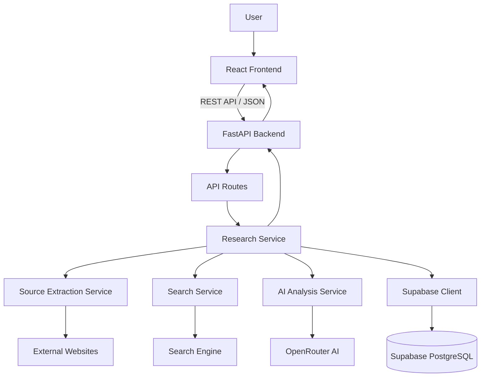

# ClarityX – System Architecture Document

## 1. Architecture Overview

ClarityX is an AI-assisted Information Gap Detection Platform designed to analyse information from multiple digital sources.

The application follows a modular client-server architecture.

The React frontend communicates with a Python FastAPI backend through REST APIs. The backend handles business logic, source extraction, AI analysis, and database operations.

Supabase provides PostgreSQL database services, while OpenRouter provides access to AI models.

## 2. Technology Stack

| Layer | Technology | Responsibility |
|---|---|---|
| Frontend | React + Vite | User interface |
| Frontend Language | JavaScript (JSX) | Application logic |
| Styling | Tailwind CSS v4 | UI styling |
| UI Components | shadcn/ui + Base UI | Reusable components |
| Backend | Python + FastAPI | REST API and business logic |
| Validation | Pydantic | Request and response validation |
| Database | Supabase PostgreSQL | Persistent data storage |
| AI Gateway | OpenRouter | AI model access |
| Content Extraction | Trafilatura | Website content extraction |
| Content Extraction | Jina Reader | Alternative website reading |
| Search | DuckDuckGo Search | Additional source discovery |
| HTTP Client | HTTPX | External HTTP requests |

## 3. High-Level System Architecture

## 4. Frontend Architecture

The frontend is responsible for user interaction and displaying research results.

### Responsibilities

- Collect research objectives.
- Accept URLs and pasted text.
- Send requests to backend APIs.
- Display analysis progress.
- Display findings and evidence.
- Show conflicting and outdated information.
- Display verification checklists.
- Retrieve and display previous research reports.

### Communication

The frontend communicates with FastAPI using HTTP requests and JSON responses. Protected endpoints require a Supabase access token in the `Authorization: Bearer <token>` header.

The frontend must never directly expose OpenRouter API keys or Supabase service-role credentials.

## 5. Backend Architecture

The backend uses FastAPI and follows a modular structure.

### Main Backend Modules

**1. Routes**

Handle incoming HTTP requests and return responses:
- Research routes (`/api/research/...`).
- Source routes (`/api/sources/...`).
- Verification routes (`/api/verification/...`).

**2. Services**

Contain application logic:
- `ai_service.py`: Orchestrates OpenRouter prompt generation, structured output parsing, and evidence quote verification.
- `extraction_service.py`: Website and text extraction with fallback policy (Trafilatura first, Jina Reader fallback).
- `search_service.py`: Optional source discovery using DuckDuckGo Search when enabled (`enable_search: true`).
- `research_service.py`: Coordinates the research workflow, enforcing timeouts, source limits, and database operations.

**3. Database**

Handles Supabase client connection, database operations, and data integrity:
- `app/database/supabase.py`: Manages Supabase client lifecycle, administrative access, centralized settings retrieval, and live pre-table connectivity diagnostics (`verify_database_connection()`).
- `app/database/repositories.py`: Encapsulates data persistence (`BaseRepository`, `ProfileRepository`, `ResearchRepository`), isolates business services from raw PostgREST calls, and sanitizes database errors to prevent secret leakage.
- `app/database/migrations/001_initial_schema.sql`: Contains PostgreSQL DDL scripts provisioning tables, cross-session validation triggers, profile synchronization triggers, indexes, and Row Level Security (RLS) policies.

**4. Schemas**

Define and validate request and response structures using Pydantic.

**5. Middleware**

Handles cross-cutting concerns including authentication verification, CORS, and request timeout monitoring.

## 6. Research Processing Workflow

When an authenticated user submits a research request:

1. The frontend sends the research objective and sources (up to 5 sources; types: `website`, `pasted_text`, `document`) with an optional `enable_search` flag (default: `false`) to FastAPI.
2. FastAPI validates the request using Pydantic schemas and enforces synchronous MVP limits (max 5 sources, 60s overall timeout).
3. The research service creates a `research_sessions` record in Supabase with `user_id` linked to the authenticated user's profile.
4. The extraction service retrieves available content:
   - Trafilatura is attempted first.
   - If extraction fails or returns fewer than 100 useful characters, Jina Reader is attempted.
   - Content is stored in `sources.extracted_content` and treated as untrusted input.
5. Each source is assigned an identifier such as S1, S2, and S3.
6. If `enable_search` is true, the search service discovers additional web sources via DuckDuckGo.
7. Extracted source texts and metadata are formatted into an AI analysis prompt.
8. OpenRouter processes the information using structured output.
9. The backend validates the AI response:
   - Evidence quotes returned by the AI are checked against the corresponding source text; unmatched quotes are flagged or rejected.
   - Never invent source IDs, citations, quotations, publication dates, or evidence.
10. Findings (categories: `missing`, `outdated`, `conflicting`, `unverified`), evidence references, and verification items are saved to Supabase:
    - Narrative recommendations are stored in `findings.recommended_action`.
    - Unresolved questions are stored as `verification_items` with `finding_id = NULL`.
    - Actionable tasks for findings are stored as `verification_items` with `finding_id` populated.
11. FastAPI returns the completed research report to the frontend, including truncated `content_preview` fields for sources to keep response payloads manageable.

## 7. AI Analysis Architecture

The AI service is responsible for analysing collected source information.

### Input

- Research objective.
- Source identifiers (S1, S2, etc.).
- Extracted source content.
- Available publication dates.
- Source metadata.

### Analysis Categories

The AI classifies gaps into four strict finding categories:

- `missing`: Missing information.
- `outdated`: Outdated or superseded information.
- `conflicting`: Contradictory information between sources.
- `unverified`: Claims lacking verifiable supporting evidence.

**Unresolved Questions:** Broader open research questions identified by the AI are captured as a distinct report section and mapped to `verification_items` with `finding_id = NULL`.

### Output

The AI returns structured data containing:

- Research summary.
- Findings list (title, category, description, severity, confidence, recommended action).
- Evidence excerpts with related source identifiers.
- Unresolved research questions.

### Important Rules

- AI-generated findings must reference real source identifiers (S1, S2).
- Evidence quotes must be verified against extracted source text.
- The system must never invent citations, quotations, publication dates, or evidence.
- Missing evidence must not be presented as proof that a claim is false.
- Unavailable publication dates must remain unknown.
- Conflicting claims must present opposing sources without arbitrarily picking a winner.
- AI output must be validated with Pydantic before being stored.

## 8. Database Architecture

Supabase PostgreSQL stores application data:

- `profiles`: User accounts (created automatically via PostgreSQL trigger on new `auth.users` records).
- `research_sessions`: Research objectives and status (`user_id` is non-null and linked to `profiles.id`).
- `sources`: Source metadata and `extracted_content`.
- `findings`: Information gaps categorized into `missing`, `outdated`, `conflicting`, `unverified`.
- `evidence_references`: Links findings to sources with explicit `ON DELETE CASCADE`.
- `verification_items`: Actionable tasks and unresolved questions (`finding_id = NULL`) with explicit `ON DELETE CASCADE`.

Row Level Security (RLS) is enabled on all tables, ensuring users can access only their own research data.

The backend communicates with Supabase using the official Supabase Python client.

## 9. External Integrations

### Trafilatura

Used as the primary extraction library to parse and extract the main article content from supported websites.

### Jina Reader

Used as a fallback content extraction service whenever Trafilatura fails or returns fewer than 100 useful characters.

### DuckDuckGo Search

Used to discover additional sources when external search is explicitly enabled (`enable_search: true`).

### OpenRouter

Used to access configurable AI models for structured information gap analysis.

All external integrations apply granular HTTP timeouts, retry guards, and size limits.

## 10. Security Architecture

- Store secrets in backend `.env` files.
- Never expose API keys or the Supabase service-role key in frontend code.
- Use Supabase Authentication from the beginning.
- Initially verify access tokens through Supabase Auth using the official Supabase Python client (`supabase.auth.get_user(token)`).
- Token verification must support the project's configured JWT signing method (`SUPABASE_JWT_SECRET` is not required for the initial implementation).
- Apply Supabase Row Level Security (RLS) on all user-owned database tables.
- Validate incoming requests with concrete Pydantic schemas.
- Restrict CORS to trusted frontend origins in production.
- Enforce synchronous MVP limits: max 5 sources and 60s overall timeout.
- Treat extracted website content as untrusted input.
- Protect against server-side request forgery (SSRF) when fetching user-provided URLs.
- Do not allow AI instructions found inside source content to override system instructions.

## 11. Error Handling

The backend should handle:

- Invalid input.
- Unsupported URLs.
- Unavailable websites.
- Extraction failures.
- Search service failures.
- AI provider errors.
- Invalid AI responses.
- Supabase connection failures.
- Authentication failures.

Errors should return consistent JSON responses with appropriate HTTP status codes.

## 12. Scalability and Future Improvements

Possible future improvements include:

- Background processing for long research tasks.
- Additional AI providers.
- More document formats.
- Advanced source reliability analysis.
- Real-time research progress updates.
- Scheduled source monitoring.
- MCP-based tool integrations where useful.

These improvements are not required for the initial MVP.

## 13. Architecture Objective

The architecture should remain modular, secure, understandable, and easy to extend.

Each service should have a clearly defined responsibility so that individual features can be developed and tested independently.

**Architecture Vision:** Build a system that connects information discovery, AI analysis, evidence tracking, and persistent research history into one reliable workflow.