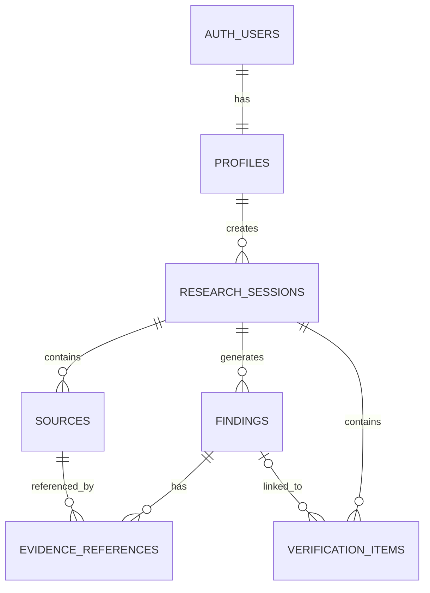

# ClarityX – Database Design Document

## 1. Database Overview

ClarityX uses Supabase as its database platform.

Supabase provides PostgreSQL for structured data storage and supports authentication, access control, and database management.

The database stores:

- User profiles.
- Research sessions.
- Submitted information sources.
- AI-generated findings.
- Evidence references.
- Verification checklist items.

The database design should maintain data consistency, prevent unauthorized access, and support retrieval of previous research reports.

## 2. Database Technology

| Component | Technology |
|---|---|
| Database | PostgreSQL |
| Platform | Supabase |
| Authentication | Supabase Auth |
| Backend Integration | Supabase Python Client |
| Access Control | Row Level Security (RLS) |

## 3. Database Tables

The initial database will contain six main tables.

### 3.1 profiles

Stores additional user profile information.

| Column | Data Type | Description |
|---|---|---|
| id | UUID | Primary key; references auth.users.id |
| full_name | TEXT | User's name |
| email | TEXT | User's email |
| created_at | TIMESTAMPTZ | Account creation time |
| updated_at | TIMESTAMPTZ | Last update time |

The profile ID matches the authenticated Supabase user ID. Profile records are created automatically through a PostgreSQL trigger whenever a new user registers in Supabase Auth (`auth.users`):

```sql
CREATE OR REPLACE FUNCTION public.handle_new_user()
RETURNS TRIGGER AS $$
BEGIN
  INSERT INTO public.profiles (id, full_name, email, created_at, updated_at)
  VALUES (
    new.id,
    COALESCE(new.raw_user_meta_data->>'full_name', ''),
    new.email,
    now(),
    now()
  );
  RETURN NEW;
END;
$$ LANGUAGE plpgsql SECURITY DEFINER;

CREATE OR REPLACE TRIGGER on_auth_user_created
  AFTER INSERT ON auth.users
  FOR EACH ROW EXECUTE FUNCTION public.handle_new_user();
```

### 3.2 research_sessions

Stores individual research requests and their analysis status.

| Column | Data Type | Description |
|---|---|---|
| id | UUID | Primary key |
| user_id | UUID | NOT NULL; references profiles.id |
| research_goal | TEXT | User's research objective |
| status | TEXT | pending, processing, completed, failed |
| summary | TEXT | AI-generated research summary |
| created_at | TIMESTAMPTZ | Creation time |
| updated_at | TIMESTAMPTZ | Last update time |

`user_id` is non-null and linked directly to `profiles.id`. Do not use mock users or nullable user IDs.

### 3.3 sources

Stores information about sources submitted or discovered during research.

| Column | Data Type | Description |
|---|---|---|
| id | UUID | Primary key |
| research_id | UUID | References research_sessions.id |
| source_code | TEXT | Identifier such as S1, S2, S3 |
| title | TEXT | Source title |
| url | TEXT | Source URL, nullable for pasted text |
| source_type | TEXT | website, pasted_text, document |
| extracted_content | TEXT | Full extracted source text |
| published_at | TIMESTAMPTZ | Publication date, if available |
| accessed_at | TIMESTAMPTZ | Date the source was accessed |
| extraction_status | TEXT | success, failed, partial |
| created_at | TIMESTAMPTZ | Creation time |

### 3.4 findings

Stores information gaps and other issues identified during AI analysis.

| Column | Data Type | Description |
|---|---|---|
| id | UUID | Primary key |
| research_id | UUID | References research_sessions.id |
| category | TEXT | missing, outdated, conflicting, unverified |
| title | TEXT | Finding title |
| description | TEXT | Explanation of the finding |
| severity | TEXT | low, medium, high |
| confidence | NUMERIC | AI confidence score (0 to 1), when available |
| recommended_action | TEXT | Narrative analytical recommendation advising the user on interpretation or investigation |
| created_at | TIMESTAMPTZ | Creation time |

The four finding categories are strictly `missing`, `outdated`, `conflicting`, and `unverified`. Note that `recommended_action` provides narrative analytical advice on the finding, whereas `verification_items.task` stores discrete, interactive checklist items.

Confidence represents model-reported confidence, not independently verified factual accuracy.

### 3.5 evidence_references

Connects findings to the sources and evidence excerpts that support or contextualize them.

| Column | Data Type | Description |
|---|---|---|
| id | UUID | Primary key |
| finding_id | UUID | References findings.id |
| source_id | UUID | References sources.id |
| evidence_text | TEXT | Relevant source excerpt verified against extracted_content |
| evidence_type | TEXT | supporting, contradicting, contextual |
| created_at | TIMESTAMPTZ | Creation time |

A finding may have multiple evidence references. When evidence is absent (e.g. for missing information), zero evidence references are attached, and the explanation is recorded in `findings.description`.

### 3.6 verification_items

Stores actionable verification tasks generated from research findings as well as broader unresolved research questions.

| Column | Data Type | Description |
|---|---|---|
| id | UUID | Primary key |
| research_id | UUID | References research_sessions.id |
| finding_id | UUID | References findings.id; nullable |
| task | TEXT | Actionable verification task description or unresolved question |
| status | TEXT | pending, completed |
| created_at | TIMESTAMPTZ | Creation time |
| completed_at | TIMESTAMPTZ | Completion time |

A verification item can be linked to a specific finding (`finding_id = findings.id`) or represent a broader unresolved research question (`finding_id = NULL`). Unresolved questions form their own dedicated section in the research report while being persisted in this table.

## 4. Table Relationships

The database follows these relationships:

- One profile can have multiple research sessions.
- One research session can have multiple sources.
- One research session can have multiple findings.
- One finding can have multiple evidence references.
- One source can be referenced by multiple findings.
- One research session can have multiple verification items.
- One finding can have multiple related verification items.

## 5. Entity Relationship Diagram



## 6. Primary Keys and Foreign Keys

- Every table uses a UUID primary key, except that profile IDs directly match `auth.users.id`.
- `profiles.id` references `auth.users.id` with `ON DELETE CASCADE`.
- `research_sessions.user_id` is NOT NULL and references `profiles.id` with `ON DELETE CASCADE`.
- `sources.research_id` references `research_sessions.id` with `ON DELETE CASCADE`.
- `findings.research_id` references `research_sessions.id` with `ON DELETE CASCADE`.
- `evidence_references.finding_id` references `findings.id` with `ON DELETE CASCADE`.
- `evidence_references.source_id` references `sources.id` with `ON DELETE CASCADE`.
- `verification_items.research_id` references `research_sessions.id` with `ON DELETE CASCADE`.
- `verification_items.finding_id` references `findings.id` with `ON DELETE CASCADE` (nullable for unresolved questions).

Explicit `ON DELETE CASCADE` guarantees that deleting a research session or finding cleanly removes dependent evidence references and tasks without leaving orphaned rows.

## 7. Constraints and Validation

Recommended constraints:

- Research status must be one of: `pending`, `processing`, `completed`, `failed`.
- Finding category must strictly be one of: `missing`, `outdated`, `conflicting`, `unverified`. (Do not add `unresolved_question` to this constraint).
- Finding severity must be: `low`, `medium`, or `high`.
- Verification status must be: `pending` or `completed`.
- Confidence must be between 0.0 and 1.0 when present.
- Source identifiers (`source_code`) must be unique within a research session (`UNIQUE(research_id, source_code)`).
- Source types must be one of: `website`, `pasted_text`, `document`.
- Source URLs should be validated before extraction.
- Required text fields must not be empty.

Use database constraints in addition to backend Pydantic validation.

## 8. Row Level Security (RLS)

Enable Row Level Security on all user-owned application tables.

Recommended policies:

- Users can view only their own profiles.
- Users can view and update only their own research sessions.
- Users can access sources belonging to their own research sessions.
- Users can access findings belonging to their own research sessions.
- Users can access evidence belonging to their own findings.
- Users can access verification items belonging to their own research sessions.

Policies should use the authenticated user's ID and verify ownership through the related research session.

The backend must never expose the Supabase service-role key to the frontend.

## 9. Indexing

Recommended indexes:

- `profiles.id`
- `research_sessions.user_id`
- `research_sessions.created_at`
- `sources.research_id`
- `findings.research_id`
- `findings.category`
- `evidence_references.finding_id`
- `evidence_references.source_id`
- `verification_items.research_id`

Primary keys already have indexes, so additional indexes should be created only where useful.

## 10. Data Integrity and Security

- Use UUIDs for identifiers.
- Use TIMESTAMPTZ for timestamps.
- Apply foreign-key constraints.
- Use RLS for user-level access control.
- Validate all incoming data.
- Avoid storing API keys or credentials in database records.
- Restrict access to extracted source content.
- Avoid saving unnecessary personal information.
- Use secure environment variables for backend credentials.

## 11. Future Database Improvements

Possible improvements:

- Full-text search across research reports.
- Source reliability metadata.
- Research tags and categories.
- Saved report sharing.
- Background task tracking.
- Source content deduplication.
- Audit logs.

These improvements can be added when required.

## 12. Database Design Objective

The database should provide a reliable and structured way to store research sessions, source information, identified gaps, evidence references, and verification progress.

**Database Vision:** Maintain a traceable history of what was researched, what was discovered, and what remains unresolved.

## 13. Schema Migration and Implementation (Phase 2)

### 13.1 Migration File
The complete PostgreSQL migration script is located at:
`backend/app/database/migrations/001_initial_schema.sql`

This single idempotent DDL script provisions:
- Core tables: `profiles`, `research_sessions`, `sources`, `findings`, `evidence_references`, `verification_items`.
- Cascade deletion: Explicit `ON DELETE CASCADE` on all foreign key relationships.
- Cross-session integrity triggers:
  - `trg_check_evidence_reference_session`: Enforces that `finding_id` and `source_id` within `evidence_references` belong to the identical `research_sessions` parent.
  - `trg_check_verification_item_session`: Enforces that any attached `finding_id` within `verification_items` belongs to the matching `research_sessions` parent.
- Auth user trigger: `on_auth_user_created` executing `public.handle_new_user()` on `auth.users` insert with upsert behavior.
- Performance indexes: 9 indexes on foreign keys, sorting timestamps, and finding categories.
- Row Level Security: Enabled on all 6 tables with restrictive policies verifying `auth.uid() = user_id` or session ownership via subquery joins.

### 13.2 Applying Migrations in Supabase Dashboard
1. Open the [Supabase Dashboard](https://supabase.com/dashboard) and select the ClarityX project.
2. Navigate to **SQL Editor** in the left sidebar.
3. Click **New Query**.
4. Copy and paste the entire contents of `backend/app/database/migrations/001_initial_schema.sql`.
5. Click **Run** (or press Ctrl+Enter / Cmd+Enter).
6. Verify output confirms success and inspect the **Table Editor** to confirm all 6 tables appear under schema `public`.

### 13.3 Database Repositories Layer
To decouple database operations and sanitize PostgREST errors, the backend provides repository abstractions in `backend/app/database/repositories.py`:
- `BaseRepository`: Provides managed client access and translates raw PostgREST `APIError` into user-safe `ClarityXException` (HTTP 400) and connection issues into `DatabaseConnectionError` without leaking database traces or keys.
- `ProfileRepository`: Handles user profile retrieval and updates.
- `ResearchRepository`: Handles research session queries and pagination with ownership guarantees.
- `SourceRepository`: Handles source persistence, sequential source-code allocation (`S1`, `S2`, ...), session ownership checks, source counting, URL listing, and 5-source capacity enforcement.

### 13.4 Migration 002: Source Capacity Limit Enforcement (Phase 5.3.1)
The PostgreSQL migration script is located at:
`backend/app/database/migrations/002_enforce_source_capacity.sql`

This migration provisions:
- **Function**: `public.enforce_source_capacity_limit()`:
  - Executes `PERFORM 1 FROM public.research_sessions WHERE id = NEW.research_id FOR UPDATE;` to lock the parent session row and serialize concurrent transactions targeting the same session.
  - Queries `SELECT COUNT(*) FROM public.sources WHERE research_id = NEW.research_id;`.
  - Raises a check violation exception if existing source count >= 5.
- **Trigger**: `trg_enforce_source_capacity_limit` on `BEFORE INSERT ON public.sources FOR EACH ROW`.
- **Application Steps**: Apply via Supabase Dashboard SQL Editor as documented in Section 13.2.
